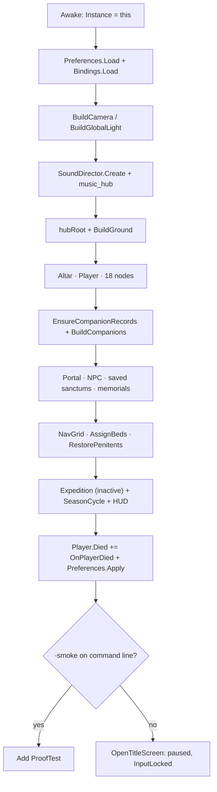

# Bootstrap and game loop

`HarvestGame` is the template's single entry point. It builds the entire hub,
owns the camera and HUD, creates the (disabled) expedition, and dispatches every
player command. This page walks through its lifetime, the public surface it
exposes to the rest of the codebase, and the interaction methods that other
systems call.

File: `Assets/ChosenOfTheHarvest/Scripts/Core/GameBootstrap.cs`, type
`ChosenOfTheHarvest.HarvestGame`, `Version = "1.0.0"`.

## Lifetime: Awake, no Start

`HarvestGame` has an `Awake` and an `Update`. There is deliberately **no `Start`**:
one-time construction happens in `Awake`, in a fixed order, so that every later
caller can assume the world exists.

```csharp
void Awake()
{
    Instance = this;
    Preferences.Load();
    Bindings.Load();
    Application.targetFrameRate = 60;
    Application.runInBackground = true;
    Screen.SetResolution(1600, 900, FullScreenMode.Windowed);
    hubBounds = new Vector2(WorldWidth / 2f - 1f, WorldHeight / 2f - 1f);

    BuildCamera();
    BuildGlobalLight();

    Audio = SoundDirector.Create(transform);
    Audio.PlayMusic("music_hub");

    hubRoot = new GameObject("Hub");
    hubRoot.transform.SetParent(transform, false);

    BuildGround();
    BuildHarvestAltar();
    BuildPlayer();
    BuildResources();
    HarvestState.EnsureCompanionRecords();
    BuildCompanions();
    BuildPortal();
    BuildNpc();
    SpawnSavedSanctums();
    SpawnSavedMemorials();
    RebuildNavGrid();
    AssignBeds();
    RestorePenitents();

    var dungeonGo = new GameObject("Expedition");
    dungeonGo.transform.SetParent(transform, false);
    ExpeditionRef = dungeonGo.AddComponent<Expedition>();
    dungeonGo.SetActive(false);

    dayCycle = gameObject.AddComponent<SeasonCycle>();
    dayCycle.PhaseChanged += OnDayPhaseChanged;
    HarvestHudRef = HarvestHud.Create(dayCycle);
    Player.Died += OnPlayerDied;
    Preferences.Apply();

    bool smoke = System.Array.IndexOf(System.Environment.GetCommandLineArgs(), "-smoke") >= 0;
    if (smoke) gameObject.AddComponent<ProofTest>();
    else OpenTitleScreen();
}
```



Two consequences of doing everything in `Awake`: the title screen opens with
`Time.timeScale = 0f` and `InputLocked = true`, so hub simulation does not run
while the menu is up; and loading a save later cannot re-run `Awake`, so
`ApplyLoadedSave` destroys and respawns companions, sanctums and memorials instead.

!!! note "Construction constants"
    The hub is 40 × 30 world units, with 10 trees and 8 rocks
    (`WorldWidth`, `WorldHeight`, `TreeCount`, `RockCount`). Ground tiles are
    duplicated from `Art/World/ground` until the plane is covered; there is no
    Terrain or Tilemap.

## Modes

The mode enum is private, because the rest of the code should ask questions
rather than set the mode:

```csharp
enum Mode { Hub, Expedition, Interior }
```

| Transition | Entry point | What changes |
|---|---|---|
| Hub → Expedition | `EnterExpedition(int act)` | `hubRoot.SetActive(false)`, expedition activated, `HarvestState.RollCurse()`, health refilled, `music_dungeon` |
| Expedition → Hub | `ExitExpedition(bool loot)` | `ExpeditionRef.End()`, hub reactivated, `ClearRunState()`, player returned to `hubReturnPosition`, autosave when `loot` |
| Hub → Interior | `EnterInterior(Sanctum building)` | `hubRoot.SetActive(false)`, `interiorRoot` built from the sanctum's record, camera distance 8.2 |
| Interior → Hub | `ExitInterior()` | `interiorRoot` destroyed, player restored to `interiorReturnPosition` |

The public read-only views of that private state are `InExpedition`, `InInterior`
and `IsPlacing`; `IsNight` and `IsDusk` come from the `SeasonCycle` instead.

`EnterExpedition()` without an argument clamps `currentAct` to 0–2. A pilgrimage
is gated: `if (mode != Mode.Hub || ceremonyRunning) return;`.

!!! warning "Mode is not a scene load"
    Hub, dungeon and interior all coexist as GameObjects under `HarvestGame`.
    Entering a dungeon disables `hubRoot`; it does not unload anything, so hub
    companions keep their state and their records.

## Input lock

`public static bool InputLocked` is a global gate, not a per-system flag. It is
read by `PlayerController.Update` (movement, attack, dodge, rite, bomb),
`CompanionAgent`, `Sanctum.Update`, and `SeasonCycle.Update`; when true the world
freezes conceptually without changing `Time.timeScale`.

It is set by:

| Action | Sets |
|---|---|
| Title screen, pause menu, any `ShowMenu` | `InputLocked = true` (`HarvestHud.ShowMenu`) |
| Resuming / `HideMenu` | `InputLocked = false` |
| Ceremony coroutine | `true` for the duration |
| Placement (`BeginPlacement`, `BeginMove`) | `true` until confirm or cancel |
| Photo mode | `true` until `ExitPhotoMode` |

Because it is static, a menu opened by any system blocks the player everywhere.
That is the intent: one modal at a time.

## The frame: Update dispatch

The first three guards are worth memorising when you add a hotkey: rebinding and
photo mode consume the frame entirely, and `paused` returns before the camera is
updated (that is why the pause menu shows a frozen frame). After that the order
is fixed:

1. `FollowCamera()` and `UpdateStatus()`.
2. Interior mode: `Interact()` on the interact binding, then `UpdatePrompt()`,
   then return.
3. Hub mode, unlocked: `SagaSystem.Evaluate(this)` at most once per second.
4. Mute, then the placement branch (which consumes the frame), then `InputLocked`.
5. Save, load, potion, Escape/pad-start pause.
6. Q cycles the weapon, Z cycles the rite, E interacts, B builds, F opens the
   roster, I the inventory, K the catalog (hub only), C the map, J the quest log,
   R the nearest sanctum's management menu.
7. `UpdatePrompt()` for the contextual hint.

## Camera, stage and HUD wiring

The camera is orthographic-free: a perspective camera at a fixed 45° pitch,
looking along `Stage3D.BillboardRotation`, with sprites tilted to face it. There
is no 2D pipeline camera trick beyond `transparencySortMode = CustomAxis` and
`transparencySortAxis = (0,0,1)`.

```csharp
void BuildCamera()
{
    var go = new GameObject("Main Camera");
    go.tag = "MainCamera";
    go.AddComponent<AudioListener>();
    Cam = go.AddComponent<Camera>();
    Cam.orthographic = false;
    Cam.fieldOfView = Stage3D.CameraFov;
    Cam.nearClipPlane = 0.3f;
    Cam.farClipPlane = 100f;
    Cam.clearFlags = CameraClearFlags.SolidColor;
    Cam.backgroundColor = new Color(0.98f, 0.96f, 0.86f);
    Cam.transparencySortMode = TransparencySortMode.CustomAxis;
    Cam.transparencySortAxis = new Vector3(0f, 0f, 1f);
    cameraBase = Stage3D.P(0f, -3f) + CameraOffset;
    Cam.transform.position = cameraBase;
    Cam.transform.rotation = Stage3D.BillboardRotation;
}
```

Camera follow is `FollowCamera`, called from `Update` before dispatch. It clamps
the target to the current mode's bounds (hub 14 × 11, interior 2.2 × 1.6, dungeon
`Player.Bounds`), eases distance, and applies screen shake. The sky colour is
owned by `SeasonCycle` (`Apply()` writes `Cam.backgroundColor`), so a phase change
repaints the background without touching the bootstrap.

`HarvestHud.Create(dayCycle)` builds the whole UI and returns the component; the
bootstrap keeps it as `HarvestHudRef` and calls `SetPrompt`, `Toast`, `ShowMenu`,
`HideMenu`, `SetVisible`, `SetGameplayVisible`, `SetUiScale`, `SetFpsVisible`,
`SetHighContrast`, `ShowWarden`, `HideWarden`, `SetMinimap` and `FlashFade`.

The light is one global `Light2D` (`BuildGlobalLight`), intensity 1, white. The
URP 2D renderer is otherwise untouched at runtime.

## Building the hub

`BuildGround` tiles the ground sprite; `BuildHarvestAltar` places the statue and
the altar and adds `HarvestAltar`; `BuildPlayer` attaches a billboard, a
`PoseAnimator` and `PlayerController`, then sets `Player.Bounds = hubBounds`.

`BuildResources` spawns 10 trees and 8 rocks through `SpawnNode`, each with a
`GatherNode`, a shadow, and a randomised position that keeps clear of the altar,
the spawn point and the portal.

`SpawnCompanion(index)` is the only companion factory. It resolves the record,
prefers `Art/Characters/<lowercase name>` then falls back to
`Art/Characters/companion`, builds the billboard, adds `CompanionAgent`, calls
`BindRecord`, and creates a `CompanionNameTag`.

```csharp
public void SpawnCompanion(int index)
{
    HarvestState.EnsureCompanionRecords();
    var record = HarvestState.CompanionAt(index);
    if (record == null) return;

    var sprite = Resources.Load<Sprite>("Art/Characters/" + record.name.ToLowerInvariant());
    bool namedPortrait = sprite != null || record.name == "Amara";
    if (sprite == null) sprite = Resources.Load<Sprite>("Art/Characters/companion");
    // ... billboard, PoseAnimator, shadow, CompanionAgent, BindRecord, name tag
    companions.Add(agent);
}
```

Recruiting is `RecruitCompanion()` (caps at 30), death is `CompanionDied` (which
builds a `MemorialData` and offers the memorial menu), and `RemoveLastCompanion`
is internal bookkeeping used when the count shrinks.

## Public surface

Properties, in the order they are declared:

| Member | Type | Meaning |
|---|---|---|
| `Version` | `const string` | `"1.0.0"`, shown in the pause title |
| `Instance` | `static HarvestGame` | The singleton; null before `Awake` |
| `InputLocked` | `static bool` | Global input gate |
| `Cam` | `Camera` | The generated main camera |
| `HarvestAltarRef` | `HarvestAltar` | The hub altar |
| `Player` | `PlayerController` | The Sovereign |
| `ExpeditionRef` | `Expedition` | The dungeon component (inactive in hub) |
| `HarvestHudRef` | `HarvestHud` | The generated HUD |
| `Audio` | `SoundDirector` | The generated audio director |
| `StatusLine` | `string` | Refreshed each frame by `UpdateStatus` |
| `InExpedition` / `InInterior` | `bool` | Mode queries |
| `IsNight` / `IsDusk` | `bool` | Delegated to `SeasonCycle` |
| `Companions` | `IReadOnlyList<CompanionAgent>` | Live agents, index-aligned with records |
| `Sanctums` | `IReadOnlyList<Sanctum>` | Placed buildings, index-aligned with `Data.buildings` |
| `HasTeaHouse` | `bool` | Any `SanctumType.TeaHouse` placed |
| `FoodSpot` / `HaulSpot` | `Vector3` | Where companions eat / deposit |
| `FeastCost` | `int` | 4 food with a kitchen, 8 without |
| `IsPlacing` | `bool` | A placement ghost exists |
| `PhotoModeActive` | `bool` | Photo mode is running |
| `CampaignStage` | `int` | `Data.campaignStage` clamped to 0–3 |
| `AverageHunger` | `float` | Mean hunger across live agents |

`FoodSpot` prefers the first kitchen and falls back to the altar; `HaulSpot`
prefers the first storage building. Both return an altar-relative point if
nothing is placed, so companions always have a target.

## Interaction methods

These are the entry points the HUD, player and dungeon call.

| Method | Purpose |
|---|---|
| `Interact()` | Context action for the current mode: door in an interior, `Expedition.Interact` in a dungeon, else NPC → portal → memorial → building → node → altar |
| `Build(SanctumType)` | Legacy instant build in a free row slot; checks cost, places, pays |
| `BeginPlacement(SanctumType)` / `BeginMove(Sanctum)` | Grid ghost placement, locks input |
| `SetPlacementCursor(Vector3)` / `ConfirmPlacement()` / `CancelPlacement()` | Placement control, also driven by WASD/Q/E/Esc |
| `PlaceAt(SanctumType, Vector3)` | Direct placement at a world point; used by `ProofTest` |
| `ShowBuildMenu(int page = 0)` / `ShowInteriorBuildMenu()` | Menu wrappers |
| `EnterInterior(Sanctum)` / `ExitInterior()` | Interior mode |
| `PlaceInteriorPiece(string type)` / `ResolveInteriorPosition(Vector3, float)` | Interior decoration & collision |
| `RepairSanctum` / `UpgradeSanctum` / `RemoveSanctum` | Building management |
| `CycleWeapon()` / `CycleRite()` | Advance the equipped ids and persist them |
| `ShowCeremonyMenu()` / `StartCeremony(CeremonyType)` / `SharpenBlade()` | Altar ceremonies |
| `ShowCompanionRoster(int page = 0)` | Roster, duties, beds, jobs, feeding |
| `ShowCampaignMap()` / `ShowQuestLog()` / `ShowInventory()` | Menus |
| `ShowAttireMenu(int page = 0)` / `ShowOmenMenu(Action onDone)` | Loadout and omen choice |
| `ShowCatalogMenu()` / `ShowCatalogSection(int, int)` / `CatalogSummary()` | Read-only content browser |
| `SpawnCompanion(int)` / `RecruitCompanion()` / `CompanionDied(...)` | Roster lifecycle |
| `UsePotion()` / `ConsumeFoodFor(CompanionAgent)` / `DepositHaul(...)` | Consumables and hauling |
| `EnterExpedition()` / `EnterExpedition(int)` / `ExitExpedition(bool)` / `WardenDefeated(int, string)` | Pilgrimage flow |
| `SaveGame` (private) / `LoadGame()` | Persistence |
| `OpenPauseMenu()` / `ShowTitleScreen()` | Modal flow |
| `EnterPhotoMode()` / `ExitPhotoMode()` | Photo mode |
| `SetCameraDistance(float)` / `Shake(float, float)` / `HitStop(float)` / `HitFeedback(Vector3, float)` / `FlashTransition()` | Presentation feedback |
| `Toast(string)` / `FloatingText(Vector3, string, Color)` | Transient text |

!!! note "Ceremonies are coroutines"
    `StartCeremony` validates food/pearls/companion count, then runs
    `CeremonyRoutine`, which sets `ceremonyRunning`, locks input, seats every
    companion at the altar, waits 3.4 s, and only then pays out. The altar
    cooldown is 30 s and is tracked by `HarvestAltar.MarkUsed()`.

## Saving from the loop

`SaveGame` is private; it is reached with `F5`, the pause menu, or the slot
menu. It flushes hauls, copies dirt and condition from live sanctums into their
records, re-points each record, then calls `HarvestSaveSystem.Save()`.
`LoadGame()` loads the active slot, repairs records, and calls `ApplyLoadedSave`,
which respawns sanctums, companions and memorials in place. Autosave only happens
on a victorious return from a pilgrimage (`HarvestSaveSystem.Autosave()`), and it
respects `Preferences.Autosave`.

## Photo mode

`EnterPhotoMode` pauses time, hides the HUD and every `CompanionNameTag`, and
detaches the camera. `PhotoUpdate` moves the target with WASD/arrows, zooms with
the wheel (4–16 units), and on F12 captures the backbuffer to
`persistentDataPath/Photos/photo_yyyyMMdd_HHmmss.png`. Esc returns to the pause
menu, not to play.

## The `-smoke` hook

Launching a player or the Editor play mode with `-smoke` on the command line adds
`ProofTest` instead of opening the title screen:

```csharp
bool smoke = System.Array.IndexOf(System.Environment.GetCommandLineArgs(), "-smoke") >= 0;
if (smoke) gameObject.AddComponent<ProofTest>();
else OpenTitleScreen();
```

`ProofTest` redirects saves to a scratch root (`HarvestSaveSystem.UseTestRoot("ProofTest")`),
drives audio, four producing buildings, a pilgrimage, a curse, an omen, the
kitchen discount, save/load and the menu, then writes `state.txt` next to
`persistentDataPath` for screenshot tooling. It is inert without the flag: its
`Start` disables the component.

!!! warning "Do not ship the smoke path"
    `-smoke` writes files and mutates a test save root. Keep it out of store
    builds by not launching with that argument; no build script strips it.

## Related

- [Architecture overview](overview.md)
- [State and save data](state-and-save.md)
- [Core API reference](../reference/core.md)
- [Controls](../getting-started/controls.md)
