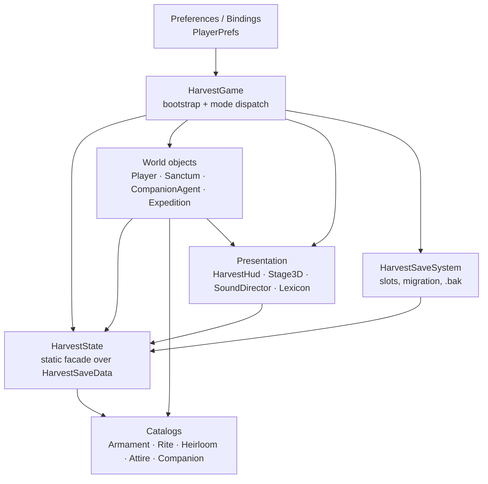
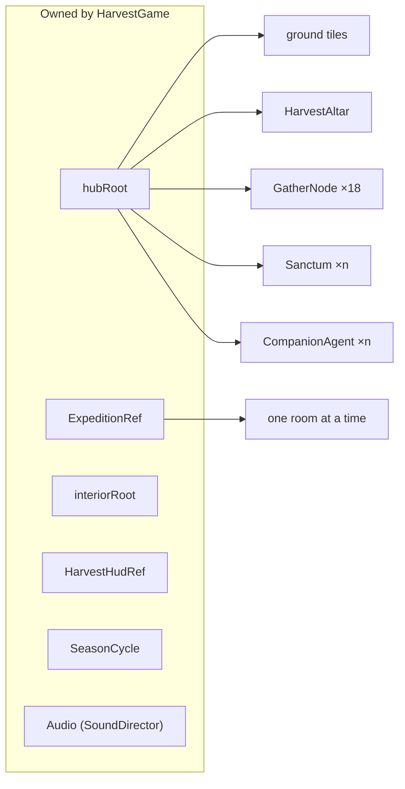
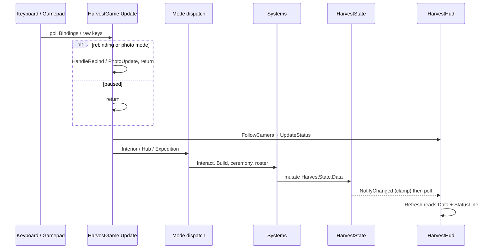

# Architecture overview

Chosen of the Harvest is a runtime-assembled Unity template: one scene, one
`MonoBehaviour`, and no prefabs. Everything the player sees — camera, ground,
buildings, companions, HUD, dungeon — is created from code when the game starts.
This page explains the layers that make that possible, how a frame travels
through them, and which rules keep the codebase reskinnable.

## One scene, zero prefabs

The only authored scene is `Assets/ChosenOfTheHarvest/Scenes/ChosenOfTheHarvest.unity`.
It contains a single GameObject named `Game` with one component, `HarvestGame`.
There are no prefab assets, no `[SerializeField]` graph, and no scene references
to repair:

```csharp
// Editor/BuildGame.cs — the scene is generated, not hand-authored.
var scene = EditorSceneManager.NewScene(NewSceneSetup.EmptyScene, NewSceneMode.Single);
var game = new GameObject("Game");
game.AddComponent<HarvestGame>();
EditorSceneManager.SaveScene(scene, ScenePath);
```

Every object that lives in the world is built by `HarvestGame.Awake` through
helpers in `Stage3D` (`CreateBillboard`, `CreateFlat`, `CreateShadow`) and every
piece of UI is built by `HarvestHud.Create`, which constructs the Canvas, its
`CanvasScaler`, all `Text` labels and the menu panel in code.

!!! note "Why this matters for a template"
    A buyer can rename the project, drop in new sprites and audio, and press
    Play. Nothing breaks because a prefab GUID moved, because there are no
    prefabs to move. The cost is that the bootstrap file is large.

## The four layers

The code is organised in four layers with a strict downward dependency: each
layer may talk to the ones below it, never above.

| Layer | Owner | Responsibility |
|---|---|---|
| **Bootstrap** | `HarvestGame`, `ProofTest` | Lifetime, mode switching, input routing, menus, ceremonies, building, photo mode |
| **State** | `HarvestState`, `HarvestSaveData`, `HarvestSaveSystem`, `Preferences` | The only persistent truth: resources, progression, records, slots |
| **World objects** | `PlayerController`, `CompanionAgent`, `Sanctum`, `GatherNode`, `Expedition`, `Creature` | Simulation: movement, needs, production, combat, procedural rooms |
| **Presentation** | `HarvestHud`, `Stage3D`, `PoseAnimator`, `SoundDirector`, `Lexicon` | Drawing, sorting, animation, audio, text |





## Single namespace, folder-per-domain

All gameplay types live in the namespace `ChosenOfTheHarvest`, with no assembly
definition, so everything compiles into `Assembly-CSharp` and can reference
everything else without `using` directives. The Editor scripts are the only
exception: `ChosenOfTheHarvest.EditorTools`.

| Folder | Types |
|---|---|
| `Scripts/Core` | `HarvestGame`, `HarvestState`, `HarvestSaveSystem`, `Preferences`, `Bindings`, `Lexicon`, `SoundDirector`, `SoundBank`, `SagaSystem`, `SeasonCycle`, `JourneyPacing`, `Stage3D`, `ProofTest` |
| `Scripts/Buildings` | `Sanctum`, `SanctumType` |
| `Scripts/Characters` | `PoseAnimator` |
| `Scripts/Combat` | `ArmamentCatalog`, `RiteCatalog`, `HeirloomCatalog`, `AttireCatalog` and their `*Definition` types |
| `Scripts/Dungeon` | `Expedition`, `Creature`, `WardenController`, `WardenAppearance`, `WardenArena`, `FloorPlanGenerator`, `RoomCollision`, `HexBolt`, `ExpeditionTrap`, `RunePlate` |
| `Scripts/Followers` | `CompanionAgent`, `CompanionCatalog`, `CompanionNameTag`, `NavGrid` |
| `Scripts/Player` | `PlayerController` |
| `Scripts/UI` | `HarvestHud` |
| `Scripts/World` | `HarvestAltar`, `GatherNode` |

!!! warning "Namespace names are the API"
    Because there are no nested namespaces, a type name is globally unique
    inside the project. `Companion` is `CompanionAgent`, `Dungeon` is
    `Expedition`, `Building` is `Sanctum`, `Enemy` is `Creature`, `Spell` is
    `Rite`. The file names and the type names intentionally differ; use the
    type names in code.

## How a frame flows

`HarvestGame.Update` never simulates anything itself. It reads input, decides
which mode is active, and forwards to a method that opens a menu, starts a
coroutine, or mutates state. Movement and attacks live in `PlayerController.Update`
and are gated by the same flags.



The actual branches, in order, are visible in the source:

```csharp
void Update()
{
    var kb = Keyboard.current;
    if (kb == null) return;

    if (rebinding != null) { HandleRebind(kb); return; }
    if (photoMode) { PhotoUpdate(kb); return; }
    if (paused) return;

    FollowCamera();
    UpdateStatus();

    if (mode == Mode.Interior)
    {
        if (Bindings.Pressed(Bindings.Action.Interact)) Interact();
        UpdatePrompt();
        return;
    }

    if (mode == Mode.Hub && !InputLocked)
    {
        questTimer -= Time.deltaTime;
        if (questTimer <= 0f) { questTimer = 1f; SagaSystem.Evaluate(this); }
    }

    if (Bindings.Pressed(Bindings.Action.Mute)) ToggleMute();
    if (placementGhost != null) { HandlePlacementInput(kb); return; }
    if (InputLocked) { HarvestHudRef.SetPrompt(""); return; }
    // ... save, load, potion, pause, weapon/rite cycling, interact, build, menus
}
```

Two details are easy to get wrong:

- **Unity does not order `Update` calls between components.** `HarvestGame.Update`
  and `PlayerController.Update` both run in the same phase; the only contract is
  that `HarvestGame.InputLocked` is checked by the player, companions and
  buildings before they act.
- **The HUD pulls, it does not subscribe.** `HarvestState.Changed` exists and is
  invoked by `NotifyChanged`, but no shipped script subscribes. `HarvestHud.Update`
  calls `Refresh()` every frame and reads `HarvestState.Data` plus
  `HarvestGame.Instance.StatusLine`.

## Dependency rules

1. **World objects never open menus.** They call `HarvestGame.Instance` for
   `FloatingText`, `Toast`, `Shake`, `HitFeedback` and mode queries, and return.
2. **Nothing writes `HarvestState.Data` without `NotifyChanged()`.** That call is
   where resource caps are enforced, so a producer that skips it can exceed the
   cap until the next write.
3. **Catalogs are static read-only tables.** They never reference `HarvestGame`
   except through `HarvestState.Data` for the equipped id (`ArmamentCatalog.Current`).
4. **Save/load is a boundary, not a system.** `HarvestSaveSystem` serialises
   `HarvestState.Data` and nothing else; runtime objects are rebuilt from it.
5. **Presentation reads state and never owns it.** `Stage3D` has no game rules;
   `HarvestHud` holds no resource counts.

## Why this suits a reskin

- **Art is addressed by path, not by reference.** `Resources.Load<Sprite>("Art/Sanctums/" + type)`
  means a new `farm.png` replaces the farm with no code change; `ArtImporter`
  forces the sprite import settings for anything under `Resources/Art/`.
- **Numbers live in one file per family.** Damage in `WeaponCatalog.cs`, rites in
  `SpellCatalog.cs`, relics in `RelicCatalog.cs`, attire in `GearCatalog.cs`,
  costs in `Building.cs`. Rebalancing never touches the bootstrap.
- **Copy is localised through one facade.** `Lexicon.Get(key, fallback)` with
  English and a pseudo-locale in `Resources/Localization`; hard-coded fallbacks
  keep the game readable if a table is missing.
- **The HUD is generated from layout code.** Changing the accent colour or the
  reference resolution is a local edit in `Hud.cs`, not a canvas rebuild.

## Trade-offs

!!! warning "Know what you are inheriting"
    - `GameBootstrap.cs` is ~4.2k lines and owns menus, ceremonies, building and
      photo mode. It is the file you will edit most, and the one most likely to
      conflict when merging.
    - Static mutable state (`HarvestState.Data`, `HarvestGame.InputLocked`,
      `NavGrid`, `RoomCollision`) makes the systems easy to call but hard to
      unit-test in isolation; the shipped `ProofTest` drives the real game loop
      instead of mocking it.
    - Nothing is data-driven through `ScriptableObject`, so designers edit C#
      tables rather than assets in the Inspector.
    - `Resources` loading is simple but loads everything under those folders into
      the build; a shipping project with a large art budget should move to
      Addressables.

## Static state and Fast Enter Playmode

Unity 6.6 and newer let you enter Play mode **without a domain reload**, which
keeps static fields alive between sessions. The Asset Store requires packages to
work in that mode (submission guideline 2.5.h).

The template therefore resets every mutable static in a
`[RuntimeInitializeOnLoadMethod(RuntimeInitializeLoadType.SubsystemRegistration)]`
method owned by the class that declares the field:

| Class | What it resets |
|---|---|
| `HarvestGame` | `Instance`, `InputLocked` |
| `HarvestState` | `Data`, `CurrentCurse`, `RunHealthPenalty`, `Changed` |
| `Preferences` | `loaded` flag and every option to its default |
| `Bindings` | `loaded` so bindings reload from `PlayerPrefs` |
| `Lexicon` | `loaded`, `locale`, cached values |
| `SoundDirector` | `Instance` |
| `HarvestSaveSystem` | `rootOverride` |
| `Stage3D` | cached material and sprites |
| `HarvestHud` | cached font and white sprite |
| `Creature` | the `All` registry |
| `HexBolt` | the projectile pool |
| `NavGrid` | grid buffers |
| `RoomCollision` | obstacle list and bounds |

```csharp
[RuntimeInitializeOnLoadMethod(RuntimeInitializeLoadType.SubsystemRegistration)]
static void ResetStatics()
{
    Instance = null;
    InputLocked = false;
}
```

!!! warning "If you add a static field"

    Add it to the owning class's reset method. A static that survives a Play
    session is the most common Fast-Enter-Playmode bug.

## Related

- [Bootstrap and game loop](bootstrap.md)
- [State and save data](state-and-save.md)
- [Systems map](systems-map.md)
- [Core API reference](../reference/core.md)
