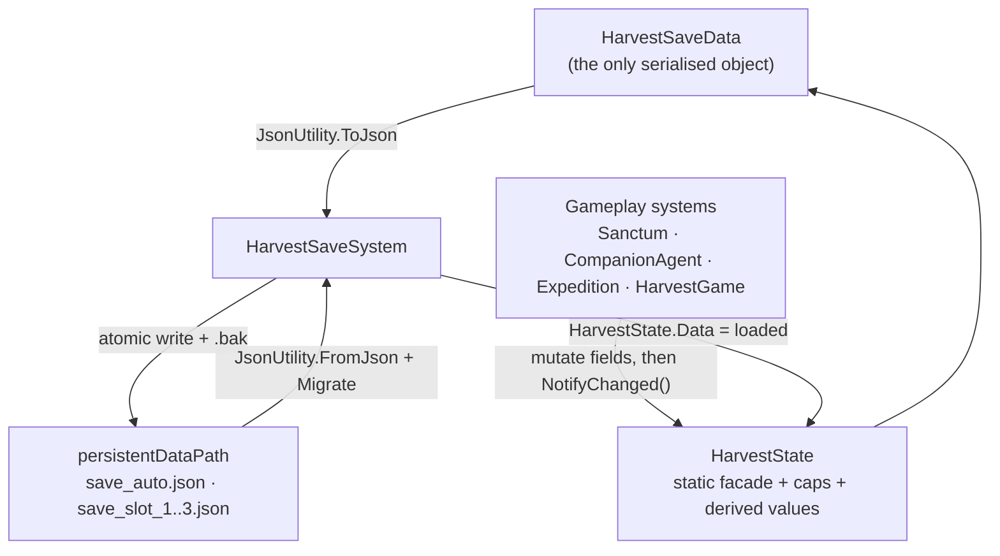

# State and save data

All durable progression lives in one serialisable object, `HarvestSaveData`, and
every system reaches it through the static facade `HarvestState`. `HarvestSaveSystem`
turns that object into JSON slots with atomic writes, a backup copy and a schema
version. This page documents the fields, the derived values computed from them,
and the exact save-on-disk contract.

## One source of truth



Nothing else is persisted. Placed buildings exist twice — as live `Sanctum`
components and as `SanctumData` records — and the bootstrap syncs them before
saving. Companion agents likewise point at `CompanionRecord` instances rather than
owning their own numbers.

## HarvestState as a facade

```csharp
public static class HarvestState
{
    public static HarvestSaveData Data = new HarvestSaveData();

    /// <summary>Runtime-only pilgrimage state; never serialized.</summary>
    public static Curse CurrentCurse;
    public static int RunHealthPenalty;

    public static event Action Changed;
    // ...
}
```

| Member | Type | Description |
|---|---|---|
| `Data` | `HarvestSaveData` | The live save object; replaced wholesale by load and reset |
| `CurrentCurse` | `Curse` | Runtime-only modifier for the current pilgrimage |
| `RunHealthPenalty` | `int` | Runtime-only max-health penalty (25 for `Frailty`) |
| `Changed` | `event Action` | Raised at the end of `NotifyChanged` |
| `Reset()` | `void` | Replaces `Data` with a fresh object and notifies |

`Reset()` is what "New game" calls, so it also resets day, resources, creed and
all records. It does **not** delete save files; that is `HarvestSaveSystem.Delete`.

!!! warning "Static data survives scene loads"
    `HarvestState.Data` is a static field, so it outlives the scene. The template
    never loads a second scene, but a host project that does must call `Reset()`
    or explicitly reload a slot.

## HarvestSaveData fields

### Meta and progress

| Field | Type | Default | Description |
|---|---|---|---|
| `saveVersion` | `int` | `4` | Schema version, compared against `HarvestSaveSystem.CurrentVersion` |
| `day` | `int` | `1` | Current day, incremented when the phase wraps to Dawn |
| `campaignStage` | `int` | `0` | Acts cleared, 0–3; clamped by `HarvestGame.CampaignStage` |
| `questStage` | `int` | `0` | Saga step, 0–8; clamped by `SagaSystem.Stage` |
| `devotion` | `int` | `0` | Permanent currency spent in meta upgrades |
| `pilgrimages` | `int` | `0` | Expeditions entered |
| `socialVersion` | `int` | `2` | Migration marker for relationship fields |
| `npcIntroSeen` / `victorySeen` | `bool` | `false` | Oracle intro played / victory screen shown |
| `creedMeta` / `creedGrace` | `string` | `""` | `communion`/`austerity`, `feast`/`industry` |
| `creedCombat` / `creedEconomy` | `string` | `""` | `zeal`/`fortitude`, `greed`/`harvest` |
| `metaVitality` / `metaWrath` | `int` | `0` | Meta levels: +15 max health / +4 weapon damage each |
| `metaProvisions` / `metaCharisma` | `int` | `0` | Provisions raises only its own cost; charisma gives +3 starting loyalty |

### Economy

| Field | Type | Default | Description |
|---|---|---|---|
| `wood` | `int` | `10` | Building material; cap `WoodCap` |
| `stone` | `int` | `0` | Building material; cap `StoneCap` |
| `grace` / `pearls` | `int` | `0` | Ceremony / dungeon currencies |
| `food` | `int` | `8` | Feeds companions and feasts; cap `FoodCap` |
| `meals` | `int` | `0` | Cooked food; cap `MealCap` |
| `herbs` | `int` | `0` | Apothecary input; cap `HerbCap` |
| `medicine` | `int` | `0` | Cures sickness; cap `MedicineCap` |
| `potions` / `bombs` | `int` | `0` | Healing / thrown consumables |
| `hymns` | `int` | `0` | Hymns performed; drives saga step 1 |

### Roster and combat

| Field | Type | Default | Description |
|---|---|---|---|
| `companions` | `int` | `4` | Roster size; records are kept in sync with it |
| `health` | `int` | `100` | Player health at save time |
| `weaponLevel` | `int` | `0` | Sharpenings bought; +5 damage each |
| `weaponType` | `string` | `"sword"` | Equipped `ArmamentDef.Id` |
| `riteType` | `string` | `"smite"` | Equipped `RiteDefinition.Id` |
| `armorId` | `string` | `"wool"` | Equipped armour `AttireDefinition.Id` |
| `charmId` | `string` | `"ember"` | Equipped charm `AttireDefinition.Id` |

### Collections

| Field | Type | Description |
|---|---|---|
| `buildings` | `List<SanctumData>` | Placed sanctums, index-aligned with `HarvestGame.Sanctums` |
| `attire` | `List<string>` | Owned attire ids, seeded with `wool` and `ember` |
| `omens` / `heirlooms` | `List<string>` | Owned omen / heirloom ids |
| `companionRecords` | `List<CompanionRecord>` | Per-companion data, index-aligned with agents |
| `memorials` | `List<MemorialData>` | Graves in the hub |

## Supporting record types

### SanctumData

| Field | Type | Default | Description |
|---|---|---|---|
| `type` | `string` | — | `SanctumType.ToString()`, parsed back with `Enum.TryParse` |
| `x` / `y` | `float` | — | Ground position; `y` is the world **z** depth |
| `level` | `int` | `1` | 1–3, clamped by `Sanctum.Init` |
| `rotation` | `int` | `0` | Odd values flip the sprite horizontally |
| `dirt` | `float` | `0` | 0–100, lowers shrine output |
| `condition` | `float` | `100` | 0–100, scales production |
| `interior` | `List<InteriorPieceData>` | `new` | Player-built interior pieces |

`InteriorPieceData` is `{ string type; int x; int z; }`. Only `type == "decor"`
contributes: `SpawnSavedSanctums` counts decor pieces and sets
`Sanctum.InteriorAuraBonus = decorations * 0.6f`.

### CompanionRecord

| Field | Type | Default | Description |
|---|---|---|---|
| `name` | `string` | `""` | Unique display name; repaired if empty or duplicated |
| `trait` | `string` | `"Loyal"` | `CompanionTrait` name |
| `level` / `xp` | `int` | `1` / `0` | Level clamped 1–5, xp non-negative |
| `age` | `int` | `0` | 0–90; under 18 is a child |
| `hunger` | `float` | `100` | 0–100 |
| `loyalty` | `float` | `70` | 0–100; below 20 is a dissenter |
| `exhaustion` / `sick` | `float` / `bool` | `0` / `false` | Fatigue 0–100 / needs medicine |
| `bed` / `job` | `int` | `-1` | Indices into `buildings`, or -1 |
| `priority` | `int` | `0` | 0–2 work priority |
| `inReflection` | `int` | `-1` | Building index while re-educating |
| `mealBuff` | `float` | `0` | 0–180 seconds of fed bonus |
| `tintR` / `tintG` / `tintB` | `float` | `0.85` / `0.75` / `0.95` | Billboard tint |
| `friend` / `partner` | `int` | `-1` | Index of a friend / partner |
| `parentA` / `parentB` | `int` | `-1` | Parent indices |
| `childDay` | `int` | `-1` | Day a child was born |

### MemorialData

| Field | Type | Description |
|---|---|---|
| `name` | `string` | Name on the grave |
| `x` / `y` | `float` | Ground position (y = world z) |
| `day` | `int` | Day of death |
| `mourned` | `bool` | A mourning ceremony has been held |
| `funeral` | `bool` | A funeral has been held |

## Derived values

These are computed, never stored. They are the only place to change when
rebalancing bonuses.

```csharp
public static int WoodCap => 250 + StorageLevels * 100;
public static int FoodCap => 100 + StorageLevels * 50;
public static int PotionCap => 20 + (HasOmen("hermit") ? 5 : 0);

public static int MaxHealth => Mathf.Max(40,
    100 + (Data.creedCombat == "fortitude" ? 40 : 0) + (HasOmen("sun") ? 15 : 0) +
    (HasOmen("priestess") ? 10 : 0) + (HasOmen("lovers") ? 5 : 0) +
    Data.metaVitality * 15 + (HasHeirloom("heart") ? 20 : 0) +
    (HasHeirloom("candle") ? 10 : 0) +
    (Data.armorId == "wool" ? 12 : 0) + (Data.armorId == "pearl" ? 15 : 0) - RunHealthPenalty);
```

| Derived value | Formula summary |
|---|---|
| `StorageLevels` | Sum of `max(1, level)` over buildings of type `Storage` |
| `WoodCap` / `StoneCap` | `250 + 100 × storage` |
| `FoodCap` | `100 + 50 × storage` |
| `HerbCap` / `MealCap` | `30 + 20 × storage` |
| `MedicineCap` | `10 + 5 × storage` |
| `BombCap` | `5 + 2 × storage + 2 (magician) + 2 (lantern)` |
| `PotionCap` | `20 + 5 (hermit)` |
| `GraceMultiplier` | 1.5 (feast creed) × omens × heirlooms |
| `GatherBonus` | `+1` with the `industry` grace creed |
| `BonusDamage` | `+8` with the `zeal` combat creed |
| `BonusPearls` | `greed` creed, `tower` omen, `ledger` heirloom, `+1` each |
| `BonusFood` | `harvest` creed, `wheel` / `empress` omens, `harvest` heirloom |
| `MaxHealth` | Base 100, creed/omen/heirloom/armour bonuses, meta vitality, minus run penalty |
| `WeaponDamage` | Armament base + bonus + `5 × weaponLevel` + omens + `4 × metaWrath`, then charm/death multipliers |
| `RiteCooldownMultiplier` | `0.8` (tide) × `0.9` (moon) × `0.75` (judgement) × `0.9` (bell) |
| `RiteDamageMultiplier` | `1.25` (mirror) × `1.1` (tome) × `1.15` (hanged) |
| `CriticalChance` | `0.08` + omen/heirloom/charm additions |
| `CriticalMultiplier` | `1.6` + `0.15` with the `devil` omen |
| `AttackCooldownMultiplier` | `0.9` (hourglass) × `0.92` (wolf) |
| `AttireLifesteal` | `1` with the `serpent` charm |
| `MoveSpeedMultiplier` | `1.12` (feather) × `1.05` (ring) × `1.05` (chariot) |
| `DamageTakenMultiplier` | `0.85` (ward) × `0.95` (cloak) × armour factor |
| `ReflectDamage` | `4` with `briar` armour |
| `HeirloomCount` | `Data.heirlooms.Count` or 0 |
| `CurseName` / `CreedName` | Localised-ish display strings for the HUD |

## NotifyChanged and the event

```csharp
public static void NotifyChanged()
{
    if (Data != null)
    {
        Data.wood = Mathf.Clamp(Data.wood, 0, WoodCap);
        Data.stone = Mathf.Clamp(Data.stone, 0, StoneCap);
        Data.food = Mathf.Clamp(Data.food, 0, FoodCap);
        Data.herbs = Mathf.Clamp(Data.herbs, 0, HerbCap);
        Data.meals = Mathf.Clamp(Data.meals, 0, MealCap);
        Data.medicine = Mathf.Clamp(Data.medicine, 0, MedicineCap);
        Data.potions = Mathf.Clamp(Data.potions, 0, PotionCap);
        Data.bombs = Mathf.Clamp(Data.bombs, 0, BombCap);
    }

    Changed?.Invoke();
}
```

`Changed` is invoked on every notify: 46 call sites in `GameBootstrap`, 8 in
`Building`, 8 in `Dungeon`, and one each in `GatherNode`, `Creature`,
`CompanionAgent`, `PlayerController`, `SeasonCycle`, `SagaSystem`, `GameState`
and `HarvestSaveSystem`.

!!! warning "The shipped HUD polls instead of listening"
    No script in the template subscribes to `HarvestState.Changed`. `HarvestHud.Update`
    calls `Refresh()` every frame and re-reads `HarvestState.Data` and
    `HarvestGame.Instance.StatusLine`. The event is therefore free to subscribe
    to from your own code, but do not expect it to be the reason the HUD updates.

## Save files and slots

| Slot | Constant | Path |
|---|---|---|
| Autosave | `AutosaveSlot = 0` | `<persistentDataPath>/save_auto.json` |
| Manual 1 | `FirstSlot = 1` | `<persistentDataPath>/save_slot_1.json` |
| Manual 2 | `FirstSlot + 1` | `<persistentDataPath>/save_slot_2.json` |
| Manual 3 | `SlotCount = 3` | `<persistentDataPath>/save_slot_3.json` |
| Legacy | — | `<persistentDataPath>/save.json` (read-only fallback for slot 1) |

`ActiveSlot` is persisted in `PlayerPrefs` under `choth_active_save_slot` and
clamped to 0–3. Manual saves update it; autosaves do not, so pressing F5 after an
autosave still targets the player's chosen slot.

`UseTestRoot("name")` repoints writes to a subdirectory and deletes its files;
this is what `ProofTest` uses. `UseDefaultRoot()` restores `persistentDataPath`.

## Writing a save

`Save(slot)` is atomic enough to survive a crash mid-write:

```csharp
HarvestState.Data.saveVersion = CurrentVersion;
HarvestState.EnsureCompanionRecords();

string path = SlotPath(slot);
string temp = path + ".tmp";
string backup = path + ".bak";
string json = JsonUtility.ToJson(HarvestState.Data, true);

Directory.CreateDirectory(Root);
File.WriteAllText(temp, json);
if (File.Exists(path)) File.Copy(path, backup, true);   // previous good save
File.Copy(temp, path, true);
File.Delete(temp);
```

`JsonUtility` is used with `prettyPrint = true`, so a save is human-readable and
diffable. The type is plain `[Serializable]` classes with public fields; there are
no custom converters, so renaming a field drops its data.

## Loading, recovery and migration

`Load(slot)` clamps the slot, falls back to the legacy `save.json` for slot 1,
then tries the primary file. If parsing fails it retries the `.bak`:

```csharp
if (!TryRead(path, out var loaded))
{
    string backup = path + ".bak";
    if (!File.Exists(backup) || !TryRead(backup, out loaded))
    {
        Debug.LogError("[Load] Both save and backup failed: " + path);
        return false;
    }
    Debug.LogWarning("[Load] primary save corrupt; loaded .bak");
}

HarvestState.Data = loaded;
Migrate();
if (slot != AutosaveSlot) ActiveSlot = slot;
HarvestState.NotifyChanged();
```

`Migrate()` runs only when `saveVersion < 4`, and then repairs unconditionally:

1. Every building gets `level ≥ 1`, `condition = 100` if non-positive, and a
   non-null `interior` list.
2. `EnsureLoadout()` repairs attire/armour/charm/rite ids.
3. Every companion record gets `inReflection ≥ -1` and `priority` clamped 0–2.
4. `saveVersion = CurrentVersion`.
5. `EnsureCompanionRecords()` then reconciles the record list with
   `Data.companions`, creates missing records, clamps needs, levels and ages, and
   de-duplicates names.

`EnsureCompanionRecords` also performs the `socialVersion` migrations: version 1
clears `friend`/`partner`, version 2 clears `parentA`/`parentB`/`childDay`. This
is separate from the file schema, because relationship fields were added after the
save format shipped.

!!! note "Slot summaries do not load the slot"
    `SlotSummary(slot)` reads the JSON only to format
    `"MM-dd HH:mm | Day N | Act N"`, where the act is
    `Clamp(campaignStage + 1, 1, 3)`. It returns `"empty"` if the file is missing.

## Autosave

```csharp
public static void Autosave()
{
    if (!Preferences.Autosave) return;
    Save(AutosaveSlot);
}
```

There is exactly one autosave trigger in the shipped game: returning from a
pilgrimage with `loot == true` (`ExitExpedition`). It is off by default only if
the player turns it off in Preferences; `Preferences.Autosave` defaults to `true`.

## Related

- [Bootstrap and game loop](bootstrap.md)
- [Architecture overview](overview.md)
- [Core API reference](../reference/core.md)
- [Saving & loading guide](../guide/save-system.md)
