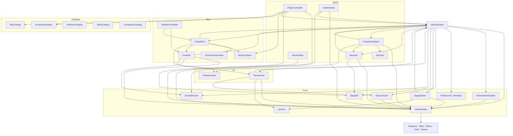
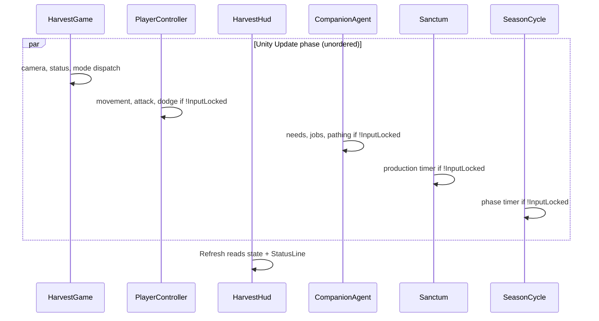

# Systems map

This page is the index you use when you know *what* you want to change but not
*where* it lives. Every gameplay system is listed with its owning script, the
types it exposes, and when it runs. The dependency graph at the end shows the
allowed call directions; the last section is a checklist for adding a system of
your own.

## Where do I find X

| System | Owning script(s) | Key types | Lifecycle |
|---|---|---|---|
| Game lifetime, modes, menus | `Core/GameBootstrap.cs` | `HarvestGame`, `HarvestGame.CeremonyType` | Built in `Awake`, dispatched in `Update` |
| Camera and billboard staging | `Core/View3D.cs` | `Stage3D`, `GroundShadow` | Static helpers called at spawn |
| Persistence | `Core/GameState.cs`, `Core/SaveSystem.cs` | `HarvestState`, `HarvestSaveData`, `HarvestSaveSystem` | Loaded on demand, written on F5/pause/autosave |
| Options and rebinding | `Core/Settings.cs`, `Core/Controls.cs` | `Preferences`, `Bindings` | `Load()` in `Awake`, `Apply()` after HUD exists |
| Localised text | `Core/Localization.cs` | `Lexicon` | Lazy `Resources.Load` on first `Get` |
| Audio | `Core/AudioManager.cs`, `Core/AudioArchive.cs` | `SoundDirector`, `SoundBank` | `SoundDirector.Create` in `Awake` |
| Day phases | `Core/DayCycle.cs` | `SeasonCycle` | Component added in `Awake`, ticks in `Update` |
| Quest chain | `Core/QuestSystem.cs` | `SagaSystem` | `Evaluate` every 1 s in the hub |
| Campaign budget text | `Core/CampaignPacing.cs` | `JourneyPacing` | Static constants only |
| Player movement and attacks | `Player/PlayerController.cs` | `PlayerController` | `Update`, gated by `InputLocked` |
| Weapon stats | `Combat/WeaponCatalog.cs` | `ArmamentCatalog`, `ArmamentDef`, `ArmamentType` | Equipped via `Data.weaponType` |
| Rites (spells) | `Combat/SpellCatalog.cs` | `RiteCatalog`, `RiteDefinition` | Cast with X, cycled with Z |
| Relics | `Combat/RelicCatalog.cs` | `HeirloomCatalog`, `HeirloomDefinition` | Owned ids in `Data.heirlooms` |
| Armour and charms | `Combat/GearCatalog.cs` | `AttireCatalog`, `AttireDefinition`, `AttireSlot` | Owned ids in `Data.attire` |
| Companion names, traits, tints | `Followers/FollowerCatalog.cs` | `CompanionCatalog`, `CompanionTrait` | Called when a record is created |
| Companion simulation | `Followers/FollowerAgent.cs` | `CompanionAgent`, `CompanionAgent.Mode` | `Update`, one agent per record |
| Companion pathfinding | `Followers/NavGrid.cs` | `NavGrid` | Rebuilt after every build/remove |
| Name tags | `Followers/FollowerNameTag.cs` | `CompanionNameTag` | Created per companion, billboarded |
| Building placement and upgrades | `Core/GameBootstrap.cs`, `Buildings/Building.cs` | `Sanctum`, `SanctumType` | `Update` production, menus for management |
| Sanctuaries and interiors | `Buildings/Building.cs`, `Core/GameBootstrap.cs` | `Sanctum`, `InteriorPieceData` | Interior built on entry, destroyed on exit |
| Resource gathering nodes | `World/ResourceNode.cs` | `GatherNode` | 3 hits, regrow after 20 s |
| Altar and ceremonies | `World/Altar.cs`, `Core/GameBootstrap.cs` | `HarvestAltar` | 30 s cooldown, coroutine payout |
| Dungeon generation | `Dungeon/Dungeon.cs`, `Dungeon/FloorPlan.cs` | `Expedition`, `FloorPlanGenerator`, `FloorRoom`, `RoomType` | `Begin(owner, act)` per pilgrimage |
| Dungeon collision | `Dungeon/RoomCollision.cs` | `RoomCollision`, `RoomCollision.Obstacle` | `Enabled` only inside a room |
| Enemies | `Dungeon/Enemy.cs` | `Creature`, `Creature.Archetype`, `Creature.EliteModifier` | Spawned per room, cleared on exit |
| Bosses | `Dungeon/BossController.cs`, `Dungeon/BossAppearance.cs`, `Dungeon/BossArena.cs` | `WardenController`, `WardenAppearance`, `WardenArena` | Two phases, act-specific moveset |
| Projectiles | `Dungeon/Projectile.cs` | `HexBolt` | Caster fire, destroyed on hit |
| Traps and rune plates | `Dungeon/DungeonTrap.cs`, `Dungeon/PressurePlate.cs` | `ExpeditionTrap`, `RunePlate` | Room-scoped, reset per room |
| HUD | `UI/Hud.cs` | `HarvestHud` | Built once, `Refresh` every frame |
| Character animation | `Characters/CharacterAnimator.cs` | `PoseAnimator`, `PoseAnimator.State` | Per-frame pose from movement state |
| Smoke test | `Core/SmokeTest.cs` | `ProofTest` | Only with `-smoke` |

!!! note "File names are not type names"
    `GameBootstrap.cs` → `HarvestGame`, `Building.cs` → `Sanctum`,
    `Dungeon.cs` → `Expedition`, `Enemy.cs` → `Creature`, `SpellCatalog.cs` →
    `RiteCatalog`, `GearCatalog.cs` → `AttireCatalog`, `FollowerAgent.cs` →
    `CompanionAgent`, `BossController.cs` → `WardenController`, `Hud.cs` →
    `HarvestHud`, `View3D.cs` → `Stage3D`, `QuestSystem.cs` → `SagaSystem`,
    `DayCycle.cs` → `SeasonCycle`, `CampaignPacing.cs` → `JourneyPacing`,
    `CharacterAnimator.cs` → `PoseAnimator`.

## Dependency graph

Arrows mean "may call". There are no cycles below the bootstrap: only
`HarvestGame` is allowed to know about everything.



Two things the graph makes visible:

- `HarvestState` reaches into the catalogs for equipped ids and bonus maths, so
  catalogs must stay free of gameplay side effects.
- `SagaSystem` needs `HarvestGame` (to inspect `Sanctums` and raise toasts), which
  is why it is evaluated by the bootstrap rather than running on its own.

## Update order inside one frame

`Update` order between components is not guaranteed by Unity, so the template
makes every system self-gating on `HarvestGame.InputLocked` rather than relying on
ordering.



## How to add a new system

1. **Pick the layer.** If it owns persistent numbers, it belongs beside
   `HarvestState`. If it is a live object, it belongs in `Scripts/World`,
   `Scripts/Dungeon` or `Scripts/Followers`. If it is a table, it belongs in
   `Scripts/Combat` next to the other catalogs.
2. **Add state, not statics.** Put new persistent fields on `HarvestSaveData`,
   give them an initializer, and mutate through `HarvestState.Data`. New fields
   are picked up automatically by `JsonUtility`; absent fields keep their
   initializer on old saves.
3. **Gate on `InputLocked`.** Anything with an `Update` must return early when
   the flag is set, exactly like `Sanctum` and `CompanionAgent`.
4. **Notify once.** Batch the mutations, call `HarvestState.NotifyChanged()` at
   the end so caps apply and listeners fire.
5. **Spawn from the bootstrap.** Add a `Build…`/`Spawn…` method to `HarvestGame`
   and call it from `Awake` in dependency order; keep a list if the system needs
   to be saved or rebuilt.
6. **Expose text through `Lexicon`.** Use `Lexicon.Get("your.key", "Fallback")`
   and add the key to both `Resources/Localization/en.json` and `xx.json`.
7. **Hook one hotkey.** Add the key to `Update`, or add an action to
   `Bindings.Action` and a default in the `Defaults` array.

A minimal, correctly-wired component looks like this:

```csharp
public class TitheChest : MonoBehaviour
{
    float timer;

    void Update()
    {
        if (HarvestGame.InputLocked) return;   // respect menus, ceremonies, placement

        timer += Time.deltaTime;
        if (timer < 20f) return;
        timer -= 20f;

        HarvestState.Data.grace += 1;          // mutate state
        HarvestState.NotifyChanged();          // clamp caps + raise Changed
        HarvestGame.Instance.FloatingText(
            Stage3D.Above(transform.position, 1.5f), "+1 grace", Color.white);
    }
}
```

!!! warning "If you add a save field that needs repair"
    `HarvestSaveSystem.Migrate()` only runs when the file's `saveVersion` is
    lower than `CurrentVersion`. Adding a field does not require a version bump;
    changing the meaning of an existing field does. In that case raise
    `CurrentVersion` **and** extend `Migrate()` so old slots are repaired rather
    than silently misread.

## Where each system's state lives

| If the value must survive a restart… | Put it in |
|---|---|
| Resources, day, devotion, creeds, omens, heirlooms, attire | `HarvestSaveData` scalar/list fields |
| Anything about one companion | `CompanionRecord` |
| Anything about one building | `SanctumData` |
| A grave | `MemorialData` |
| Audio volumes, language, keybinds, difficulty | `Preferences` / `Bindings` (PlayerPrefs) |
| The current pilgrimage's curse | `HarvestState.CurrentCurse` (runtime only) |
| A menu's current page, placement ghost, camera distance | `HarvestGame` private fields |

## Related

- [Architecture overview](overview.md)
- [Bootstrap and game loop](bootstrap.md)
- [State and save data](state-and-save.md)
- [Catalogs API reference](../reference/catalogs.md)
