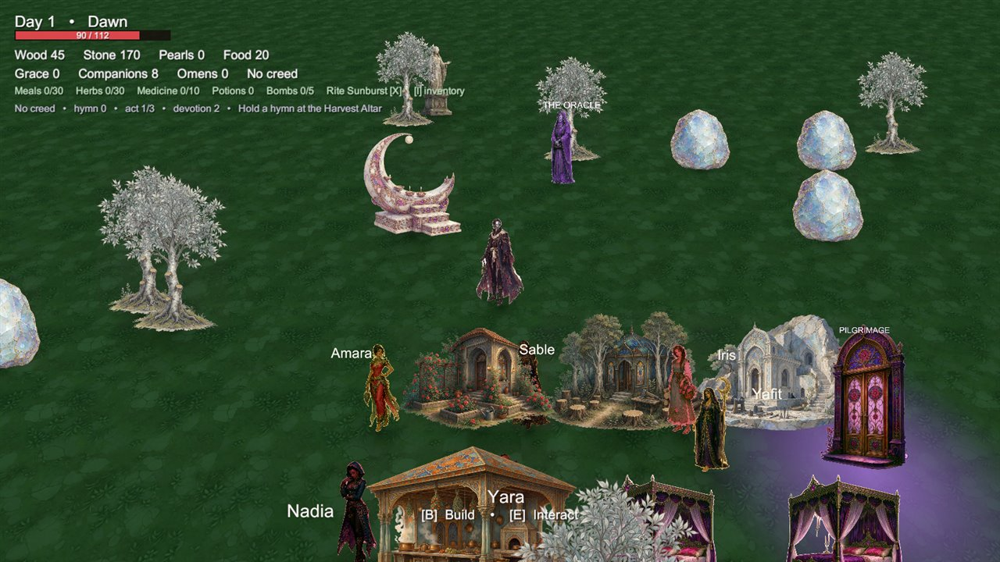
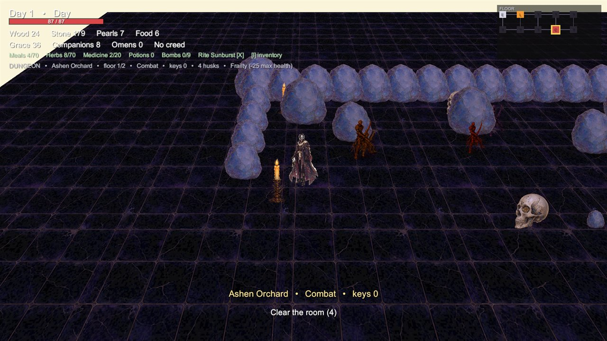

# Your first run

This page walks through the first ten minutes of the game and explains what each
system is showing you.

## The title screen

The title screen offers **New game**, **Continue**, **Load game**,
**Preferences** and **Quit**. If no save exists, **Continue** and **Load game**
are disabled.

Starting a new game creates a fresh `HarvestSaveData` and drops you into the
Harvesthold.

## The Harvesthold

The hub is a 40 × 30 unit walled settlement with:

| Object | Location | Purpose |
|---|---|---|
| **Harvest Altar** | Centre-north | Ceremonies, the quest chain's first objective |
| **Portal** | East side | Begins an expedition into the Fallow |
| **Oracle** | Near the altar | Story dialogue and guidance |
| **Merchant** | East of the altar | Buys and sells gear |
| **Companions** | Roaming | Work, eat, sleep, heal, socialise |

The HUD along the top shows the day, wood, stone, pearls, food, grace,
companions, omens, meals, herbs, medicine, potions, bombs and the current rite.

## 1. Hold a hymn

Walk to the Harvest Altar and press `E`. Choose **Hymn**.

A hymn costs grace and food, grants devotion and progresses the quest chain. It
also raises the mood of nearby companions. The first quest stage after the farm
is "Hold a hymn at the Harvest Altar".

## 2. Build a farm

Press `B` to open the build menu. Choose **Rose Garden** (the farm).

- Move the cursor to position the ghost.
- `Q` rotates.
- `E` or left click confirms; `Esc` cancels.

The farm costs wood (and needs a worker to produce at full rate). It generates
food on a 12-second interval.

## 3. Meet your companions

Press `F` for the roster. Each companion has:

- a **name** and **trait** (Loyal, Hardworking, Glutton, Devout, Sickly, Lazy);
- **hunger**, **loyalty** and **exhaustion**;
- a **job**, a **bed** and a **priority**;
- relationships (friend, partner, parents, children).

Select a companion to feed them, assign a job, assign a bed, or send them to the
Reflection Chamber. Companions who are starving, exhausted or sick work slower
and lose loyalty.

## 4. Enter the Fallow

Press `C` to open the **Pilgrimage Map**. Act I is available; Acts II and III are
locked until the previous Warden falls.

Choose **Begin pilgrimage**. You appear in the first room of a generated floor.

- Clear the room's husks to unlock the doors.
- Collect keys; some doors are locked.
- Shrines, shops, treasure, puzzles and curses appear as you explore.
- Find the stairs to descend.

## 5. Fight

| Input | Action |
|---|---|
| `Space` | Attack with the current armament |
| `Left Shift` | Dodge (brief invulnerability) |
| `X` | Cast the current rite |
| `G` | Throw a bomb |
| `Q` / `Z` | Cycle armament / rite |
| `H` | Drink a potion |

Armaments have distinct rhythms: the Fan Blade is a fast four-hit combo, the
Bell Hammer is a single wide swing that hits everything, the Thorn Claws heal on
hit. Rites are area effects with cooldowns.

## 6. Break a Warden

Each act ends with a Warden. The three are:

| Act | Realm | Warden |
|---|---|---|
| I | Ashen Orchard | The Gilded Stag |
| II | Drowned Conservatory | The Mire Queen |
| III | Ember Citadel | The Obsidian Sultan |

Wardens have multiple phases and telegraphed attacks. Their arenas change with
the act. Defeating one unlocks the next act and grants devotion.

## 7. Save and return

- `F5` saves to the active slot; `F9` loads.
- Autosave is on by default (**Preferences → Autosave**).
- Returning through the portal ends the expedition; loot is kept.

## What to try next

- Build a **Kitchen Pavilion** to make feasts cheaper.
- Build a **Reflection Chamber** to resolve a companion's crisis.
- Collect **omens** after boss fights; they change the run's rules.
- Spend **devotion** on meta-upgrades from the pilgrimage map.
- Press `K` in the hub for the catalog codex of everything you have seen.

## Related

- [Controls](controls.md)
- [The Harvesthold hub](../guide/hub-and-companions.md)
- [Combat & Wardens](../guide/combat.md)
- [Saving & loading](../guide/save-system.md)
